# 03_iptv 软件架构与实现原理

> 面向 i.MX6ULL（100ask）开发板的网络电视播放器。
> 本文讲清**软件分层、数据流、进程模型、各模块实现原理**以及**实测踩过的坑**。
>
> 对应源码：`examples/03_iptv/`（`main.c` 约 660 行是全部逻辑，另有两个部署文件）。

---

## 1. 它到底是什么

一句话：**一个不到 700 行的 C 主控进程 + 板上的 ffmpeg，把网络直播流直接解码写进 framebuffer**。

它自己**不解码、不联网、不画像素**，只做四件事：

1. 读频道表，决定"现在该播哪个 URL"；
2. 拼出一条 `ffmpeg` 命令并 `fork + execvp` 出去；
3. 监听触摸/按键/信号，把用户意图翻译成"换台/菜单/退出"；
4. 看护 ffmpeg 子进程（掉了就重连）和屏幕状态（别黑屏、别闪光标）。

### 为什么这么设计

| 取舍 | 选择 | 原因 |
|---|---|---|
| 解码器 | 复用板上的 `ffmpeg`，不自己写 | i.MX6ULL 无 VPU，软解已够呛；自己实现 H.264 解码不现实 |
| 输出方式 | 直接写 `/dev/fb0`（fbdev） | 板子没跑 X11/Wayland，fbdev 是最短路径，零依赖 |
| 进程结构 | ffmpeg 作为**子进程** | 崩溃隔离 + 换台只需杀掉重启，不用处理解码器状态 |
| 控制接口 | Unix 信号（USR1/USR2/HUP） | 无网络、无 IPC 依赖，板上 shell 一条 `kill` 就能换台，调试极方便 |
| 画面合成 | 全交给 ffmpeg 的滤镜链 | OSD/缩放/填充一次完成，主控不需要碰像素 |

---

## 2. 总体架构

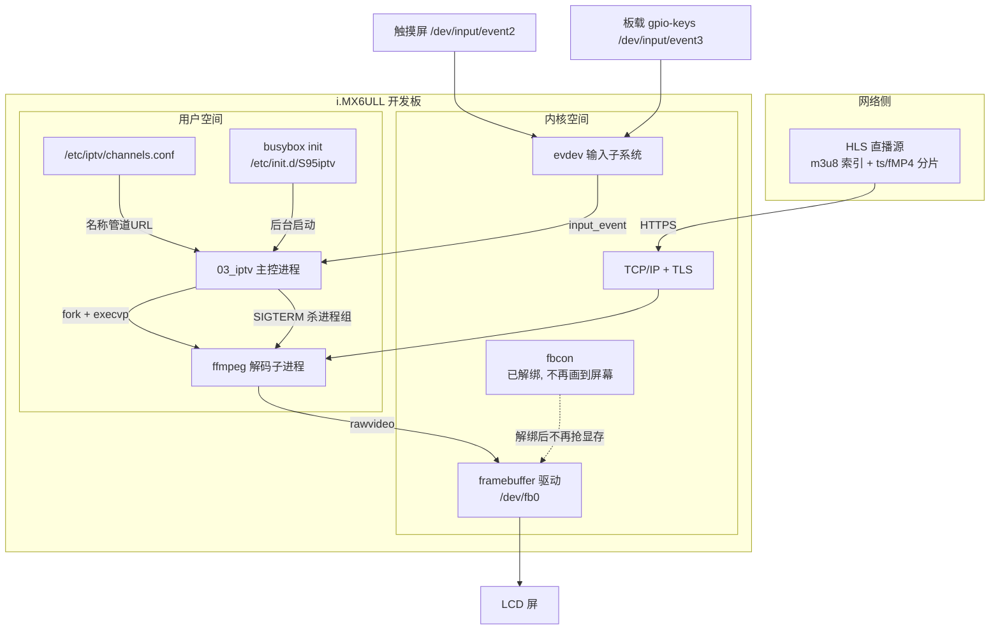

### 文件清单

| 文件 | 角色 | 部署位置 |
|---|---|---|
| `main.c` | 全部业务逻辑（主控） | 编译成 `/root/03_iptv` |
| `channels.conf` | 频道表（`名称\|URL`，`#` 注释） | `/etc/iptv/channels.conf` |
| `S95iptv` | 开机自启动脚本（联网+对时+启动播放器） | `/etc/init.d/S95iptv` |
| `Makefile` | 编译 + `make deploy` 一键部署 | — |

### main.c 内部模块划分

| 函数 | 职责 |
|---|---|
| `detect_fb()` | 探测屏幕分辨率/位深 → 决定输出像素格式 |
| `keep_screen_on()` | 防黑屏 + 去光标（每 10 秒维护一次） |
| `load_channels()` | 解析频道表 |
| `play()` | 拼 ffmpeg 命令并拉起播放（含 OSD） |
| `show_menu()` | 用 lavfi 画静态频道列表 |
| `show_notice()` | 频道表为空时的提示页 |
| `show_boot()` / `boot_media()` | 开机动画（Logo + 进度条，可跳过；支持自定义广告媒体） |
| `spawn_ffmpeg()` / `stop_play()` / `alive()` | 子进程生命周期管理 |
| `on_touch()` | 触摸区域 → 换台/菜单 |
| `on_signal()` | 信号 → 换台/菜单/退出 |
| `main()` | 参数解析、初始化、主循环 |

---

## 3. 视频数据流

从网络到屏幕，每一帧要走的路：

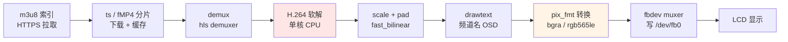

两个关键节点：

- **D（软解）是性能瓶颈**：i.MX6ULL 单核 Cortex-A7 无硬件解码，只在 CPU 上跑。
- **G（像素格式）是最容易出错的点**：必须与 fb0 的实际位深一致，否则 ffmpeg 直接写帧失败（详见 §9）。

---

## 4. 开机自启动流程

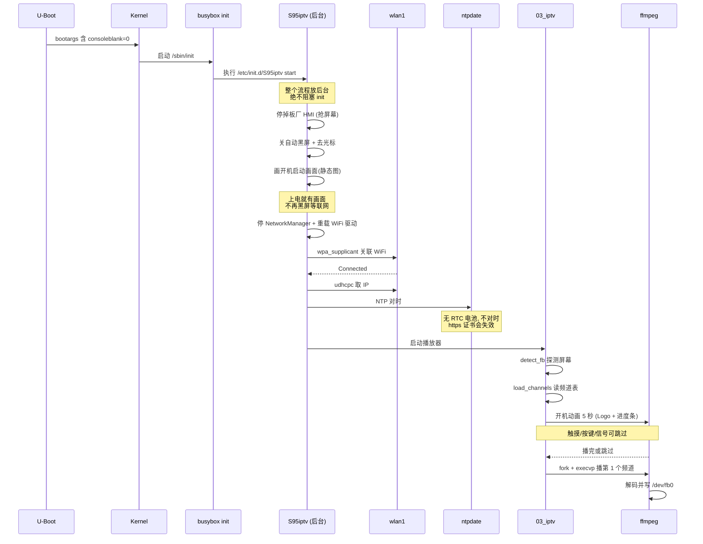

### 4.1 开机动画：两段式，消除黑屏等待

真实机顶盒开机都有广告/Logo 动画，而且**从通电起屏幕就是亮的**。原来这个程序没有这一段，
表现是"黑屏卡几十秒 → 突然进电视"，跟死机一样。所以补了**两段**：

| 阶段 | 谁负责 | 画面 | 目的 |
|---|---|---|---|
| ① 上电 → 联网完成 | `S95iptv` 脚本 | 静态图"正在启动…" | 覆盖联网 + 对时的几十秒，消灭黑屏 |
| ② 播放器启动 → 进电视 | `03_iptv` 的 `show_boot()` | 动态 Logo + 进度条（5 秒，可跳过） | 机顶盒式的开机过场 |

两个阶段的实拍画面（从 framebuffer 抓的真实屏幕）：

| 阶段① 联网时看到 | 阶段② 开机动画 |
|---|---|
|  | 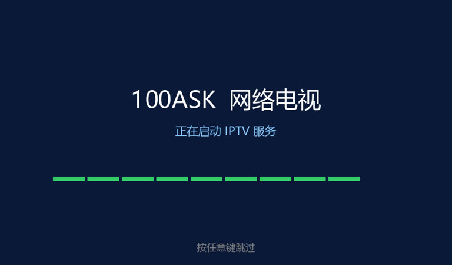 |

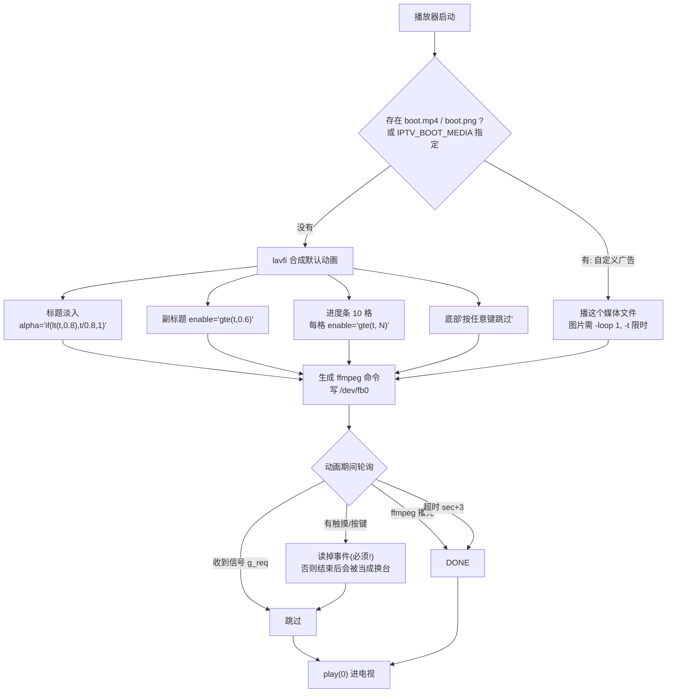

**关键实现点**

- 动画依旧由 ffmpeg 生成，主控不碰像素，同时能复用 `drawtext` 的字体。
- 滤镜表达式里出现的逗号必须转义成 `\,`，否则被当成滤镜分隔符。
- **跳过时必须把输入事件读掉丢弃**：否则这批事件留在队列里，动画一结束进入播放会立刻被当成"换台"处理。
- 跳过支持三种触发：触摸、按键、`kill -USR1`（信号，方便调试）。信号跳过不会误触发换台——`g_req` 在读到的同时就被清零了。
- 兜底：ffmpeg 若异常退出或卡住，`alive()` 检测和 `sec + 3` 超时会放行，不会卡在动画里。

**可调**

| 环境变量 | 默认 | 说明 |
|---|---|---|
| `IPTV_BOOT_SEC` | `5` | 动画时长（1~30 秒） |
| `IPTV_BOOT_MEDIA` | 无 | 指定开机广告文件路径；不设则依次找 `/etc/iptv/boot.mp4`、`boot.png`、`boot.jpg` |

放一段 mp4 到 `/etc/iptv/boot.mp4` 就是真正的"开机广告"，和机顶盒一样。

### 三个"必须"

1. **必须后台运行**：busybox init 串行执行 `/etc/init.d/S*`，任何前台阻塞都会卡死 init（串口永远等不到 shell）。所以整个流程包在 `( ... ) > log 2>&1 &` 里。
2. **必须先对时**：板子没有 RTC 电池，上电时间回到 1970，https 会报 `certificate is not yet valid`。
3. **必须关掉板厂 HMI**：`S99myirhmi2` 会跟播放器抢屏幕。

---

## 5. 进程模型与信号

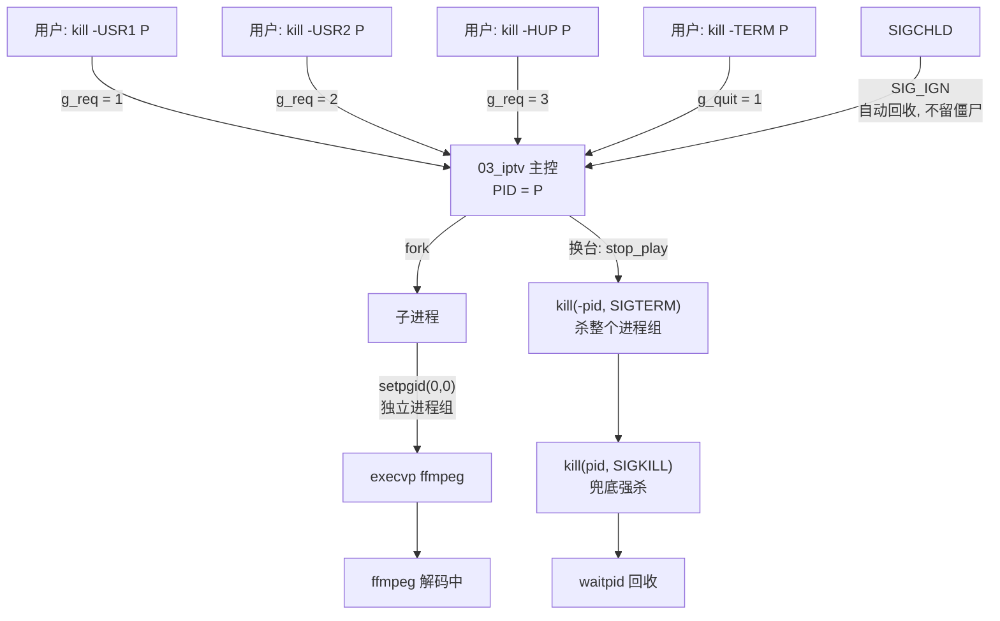

| 信号 | 作用 |
|---|---|
| `SIGUSR1` | 下一台 |
| `SIGUSR2` | 上一台 |
| `SIGHUP` | 频道列表（再发一次返回播放） |
| `SIGINT` / `SIGTERM` | 退出（并清理 ffmpeg） |

实现要点：

- 子进程 `setpgid(0, 0)` 建独立进程组，换台时 `kill(-pid, ...)` 能把 ffmpeg 的子线程一起带走。
- `SIGCHLD` 设为 `SIG_IGN`，内核自动回收，主循环不用管僵尸进程。
- ffmpeg 的 stdout/stderr 重定向到 `/dev/null`，避免日志刷在串口控制台上干扰画面。

---

## 6. 主循环

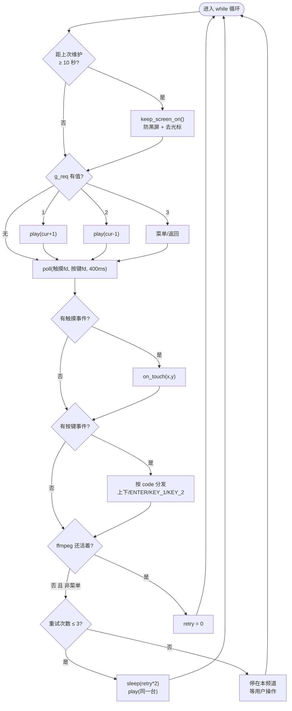

设计说明：

- `poll` 超时 400ms，所以即使没有任何输入，循环也在跑（才能做每 10 秒的屏幕维护和存活检查）。
- 触摸坐标用 `EVIOCGABS` 从驱动读真实量程再线性映射到屏幕像素——不同屏的 raw 量程不一样，硬编码会错位。
- 有些屏不上报 `BTN_TOUCH`，用 `SYN_REPORT` 兜底判定。

---

## 7. 播放状态机

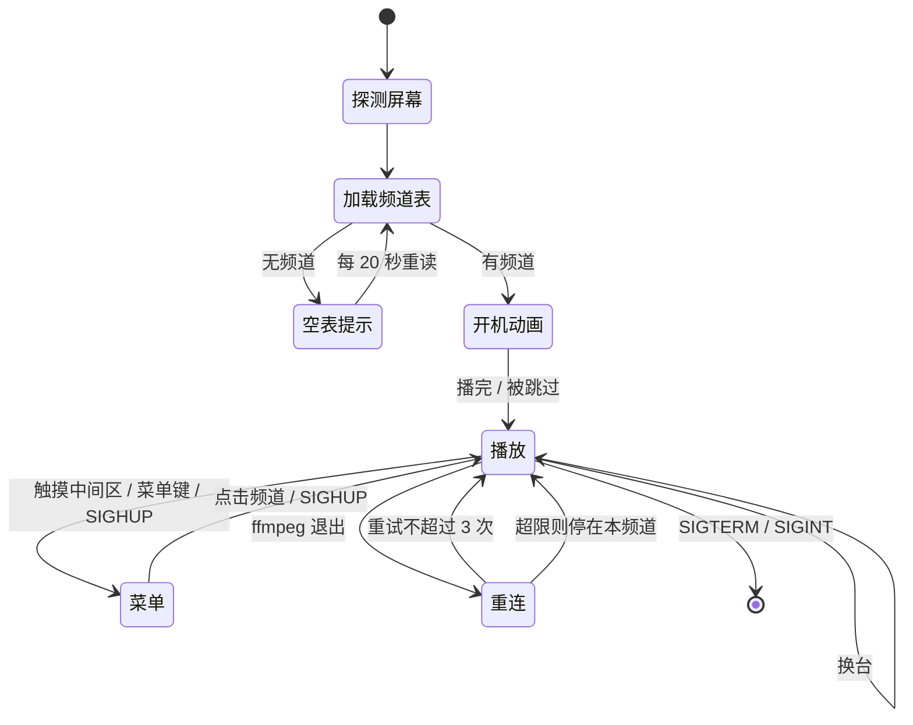

频道表为空时不退出、不留黑屏，而是在屏幕上画提示并每 20 秒重读一次——这样加完频道**不用重启程序**。

---

## 8. 断流重连

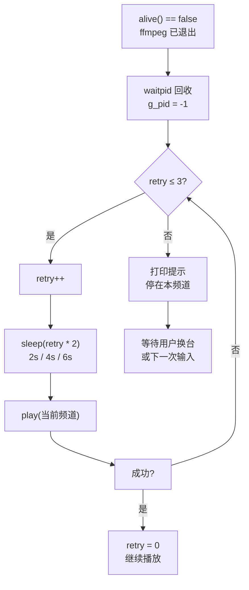

ffmpeg 侧配合：`-rw_timeout 15000000`（15 秒读不到数据就自己退出），由主控负责重连——避免 ffmpeg 卡死在一个死链上。

---

## 9. 屏幕管理：像素格式 / 防黑屏 / 去光标

这一层是本项目最"脏"的部分，三个问题都来自 framebuffer console 跟播放器抢显存。

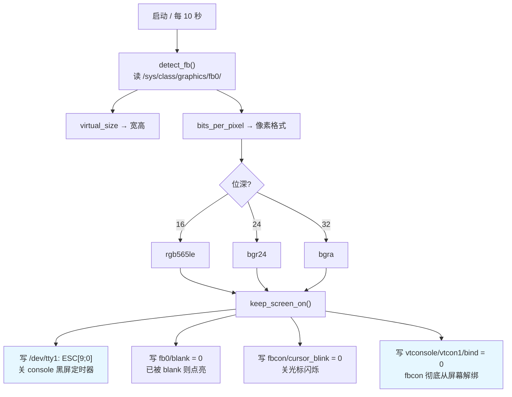

### 9.1 为什么像素格式不能写死

这块板**每次重启 fb0 参数都可能变**，实测出现过两种：

| 启动 | fb0 | 必须用的 pix_fmt |
|---|---|---|
| A | `1024x600` / 32bpp | `bgra` |
| B | `1280x720` / 16bpp | `rgb565le` |

写错的话 ffmpeg 报：

```
[fbdev] Pixel format bgra is not supported, use rgb565le
av_interleaved_write_frame(): Invalid argument
```

**症状极其隐蔽：进程正常在跑、日志正常，但画面根本没写进去。** 只能靠 `md5sum /dev/fb0` 连采两次看变没变来确认。

### 9.2 防黑屏：sysfs 那条路是死的

内核默认 `consoleblank=600`（console 空闲 10 分钟黑屏）。背光其实是好的（实测 `bl_power=0`、`brightness=8/8`），别去调背光。

`/sys/module/kernel/parameters/consoleblank` 在这块板是**只读**（`-r--r--r--`），写它只会 `Permission denied`。真正生效的三层：

| 层 | 做法 | 效果 |
|---|---|---|
| 永久 | `fw_setenv mmcargs '... consoleblank=0'` | 重启后根治 |
| 开机脚本 | `printf '\033[9;0]' > /dev/tty1` + `echo 0 > fb0/blank` | 每次开机生效 |
| 播放器 | 主循环每 10 秒重写一遍 | 防止被 tty 切换/getty 重设回去 |

### 9.3 去光标：是 vtcon1 不是 vtcon0

光标是 **fbcon 画在 framebuffer 上的**，它跟 ffmpeg 抢同一块显存（同理 printk、getty 登录提示也会叠在视频上）。

```
vtcon0 name=(S) dummy device          ← 空壳，解它没用
vtcon1 name=(M) frame buffer device   ← 真正画到屏幕的，要解这个
```

解绑后内核会打印 `Console: switching to colour dummy device 80x30`（正常现象），console 输出照常在串口 `ttymxc0`。

### 9.4 HDMI：同源镜像 + 插上就改分辨率

这块板确实有 HDMI，但不是独立显示通道：SoC（i.MX6ULL）没有 HDMI 控制器，底板上是一颗 **sii902x 发射芯片**（挂在 I2C1 的 0x39），把 **LCDIF 的并行 RGB 信号原样转成 HDMI**。它绑定的是**fb0**（`/sys/bus/i2c/devices/1-0039/fb_name` = `mxs-lcdif`）——所以 **HDMI 屏上显示的就是 fb0 的内容，和 LCD 完全同源**，不需要也不存在"第二块 framebuffer"（fb1 只是同一控制器的备用图层）。

**坑：插入 HDMI 会把 fb0 的分辨率改掉。** 驱动（`drivers/video/fbdev/mxc/mxsfb_sii902x.c` 的 `sii902x_cable_connected()`）检测到插入后会读电视 EDID，然后直接 `fb_set_var()` 改 fb0——实测从 `1024x600/32bpp` 被改成 **`1280x720/16bpp`**。不处理的话 ffmpeg 还按旧参数输出，轻则画面错位，重则因为像素格式不匹配**一帧都写不进去**（进程还在跑，看似活着）。

播放器的对策（主循环里每 2 秒查一次）：

```c
/* /sys/.../1-0039/cable_state = plugin / plugout */
fb_size_now(&w, &h);
if (w != g_w || h != g_h) {          /* 分辨率被驱动改了 */
    g_w = g_h = 0;
    detect_fb();                      /* 重新读尺寸+位深, 换像素格式 */
    play(g_cur);                      /* 用新参数重开 ffmpeg */
}
```

**更麻烦的是 LCD 会被连累：面板物理只有 1024x600，一个物理像素对一个数据像素、不会自己缩放**，拿一路 1280x720 的信号它只能按自己的时序去采，采不到的地方就是黑边——实测**左边约 1/5 黑**。

#### 一个 fb0、两块屏，分辨率只能二选一

HDMI 和 LCD 共用同一个 fb0，所以分辨率必须有个优先级。`IPTV_SCREEN` 就是干这个的：

| `IPTV_SCREEN` | fb0 会设成 | LCD 表现 | HDMI 电视表现 |
|---|---|---|---|
| 不设 / `lcd`（**默认**） | **1024x600 / 32bpp**，用面板自己的时序 | 正常，无黑边 | 电视自己把 1024x600 缩放到全屏（画面完整，略糊） |
| `hdmi` | **1280x720 / 32bpp**，CEA-861 标准时序 | 左边黑边（面板采不到） | 电视点对点，最清晰 |

两个模式的时序都是写死的常量（`main.c` 的 `MODE_LCD` / `MODE_HDMI`）：

- **LCD 时序**来自设备树 `display#1/display-timings/timing0_1024x768`——这节点名字写着 768，实测 `hactive=1024 vactive=600`、`clock-frequency=50MHz`（→ 58.59Hz）。必须照抄，换成别的时序面板就认不出信号。
- **HDMI 时序**用 CEA-861 标准 1280x720@60（驱动自己给的那组 porch 分配是偏的：前肩 194/后肩 61/同步 133 vs 标准 110/220/40）。

切换用 `fb_set_mode()`（`ioctl(FBIOPUT_VSCREENINFO)`），只改必要字段，**`sync` 极性保留驱动给的**（来自设备树的 `hsync/vsync-active`，动它画面会反色或抖）。

#### 固化到开机流程

光靠播放器启动时改还不够——从通电到播放器起来有几十秒（联网+对时），这期间屏幕上画的是"正在启动"，同样是歪的。所以 `S95iptv` 在画开机图**之前**先调一次：

```sh
/root/03_iptv --setfb     # 只改分辨率, 不启动播放
```

播放器正常启动时也会先按策略定分辨率再 `detect_fb()`；主循环里发现分辨率变了同样会按策略改回来（运行中插拔 HDMI 也覆盖）。实测插着 HDMI 开机：

```
iptv: 修正屏幕分辨率 ...
[iptv] --setfb: LCD 1024x600 -> 已切换     ← 此时 cable_state=plugin
```

实测数据：插上 HDMI 后（1280x720 + rgb565le），同一个源从 **11 FPS 降到 9.1 FPS**——分辨率多了 31% 像素，还被切到了优化较差的 rgb565 路径。HDMI 上的实拍画面：

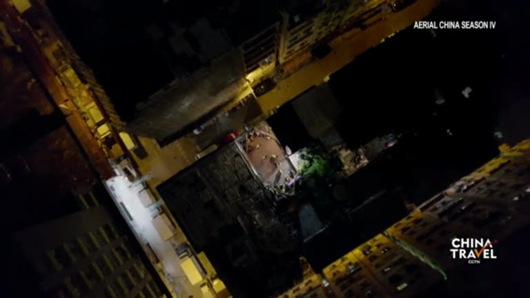

排障口诀：

```bash
cat /sys/bus/i2c/devices/1-0039/cable_state   # plugin / plugout
cat /sys/class/graphics/fb0/virtual_size      # 被改成多少了
grep SII902x_det /proc/interrupts             # 插拔一次计数 +1 说明中断正常
```

注意触摸量程仍是 LCD 的物理分辨率（x[0,1024]），坐标是按比例映射的，插拔 HDMI 不影响点击判定。

---

## 10. ffmpeg 命令是怎么拼出来的

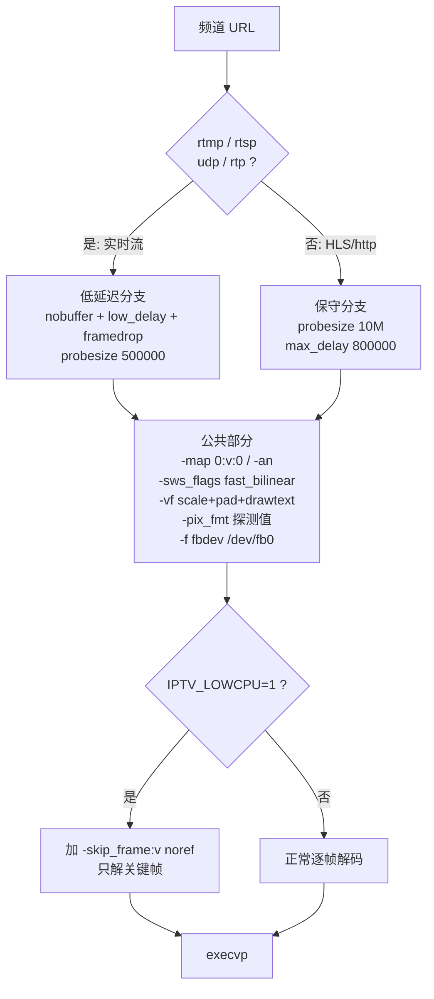

实际生成的命令：

```bash
ffmpeg -nostdin -loglevel warning \
  -rw_timeout 15000000 -probesize 10M -max_delay 800000 \
  -i "https://.../index_4.m3u8" \
  -map 0:v:0 -an \
  -sws_flags fast_bilinear \
  -vf "scale=1024:600:force_original_aspect_ratio=decrease,\
pad=1024:600:(ow-iw)/2:(oh-ih)/2:color=black,\
drawtext=fontfile=/usr/share/fonts/ttf/msyh.ttc:text='CCTV+ 直播':\
x=36:y=28:fontsize=34:fontcolor=white:shadowcolor=black:shadowx=2:shadowy=2:\
enable='lt(t,8)'" \
  -pix_fmt bgra -f fbdev /dev/fb0
```

关键参数为什么这么给：

| 参数 | 值 | 理由 |
|---|---|---|
| `-rw_timeout` | 15s | 读不到数据就退出，交给主控重连 |
| `-probesize` | 10M（实时流 500K） | HLS 需要读几个分片才能确定流信息，压太小会 `Error when loading first segment` |
| `-max_delay` | 800000 | 分片等太久就放弃（ffplay 默认值） |
| `-map 0:v:0` | — | 只取第一条视频轨，不去解多余变体 |
| `-an` | — | 默认关音频（省算力，板子也没接音箱） |
| `force_original_aspect_ratio=decrease` + `pad` | — | 保持比例居中，两侧/上下补黑边，不变形 |
| `enable='lt(t,8)'` | — | 频道名 OSD 只显示 8 秒 |
| `-sws_flags fast_bilinear` | — | 最快缩放算法，省 CPU |

低延迟参数（`nobuffer` / 极小 `analyzeduration`）**只对 rtmp/rtsp/udp/rtp 启用**——实测它们会让 HLS 和 http mp4 起播直接失败。

---

## 11. OSD 与菜单：两种画法

| 场景 | 画法 | ffmpeg 形态 |
|---|---|---|
| 频道名 OSD | 实时滤镜叠加在视频上 | `-vf ...drawtext:enable='lt(t,8)'`，随视频持续输出 |
| 频道列表 | lavfi 生成**一张静态图**覆盖 fb0 | `-f lavfi -i color=... -vf drawtext×N -frames:v 1` |
| 空频道表提示 | 同上，三行文字 | 同上 |

实际效果（左上角白字就是 8 秒 OSD；列表里当前频道是绿色高亮）：

| 播放中（360p 放大到满屏，OSD 叠加在视频上） | France 24（源正好是 1024x576，1:1 输出） |
|---|---|
| 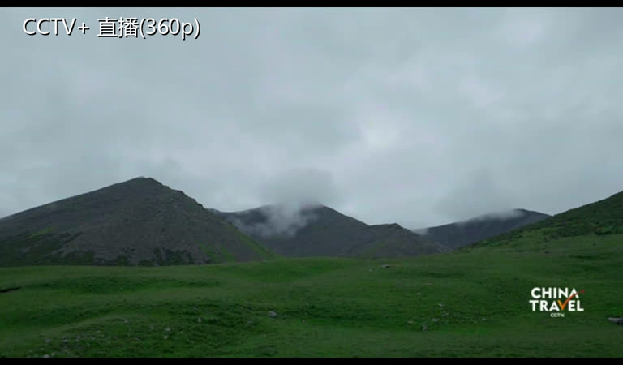 | 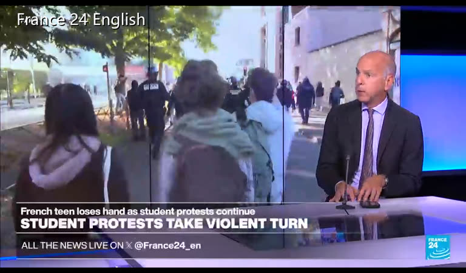 |

| 频道列表（静态图） |
|---|
| 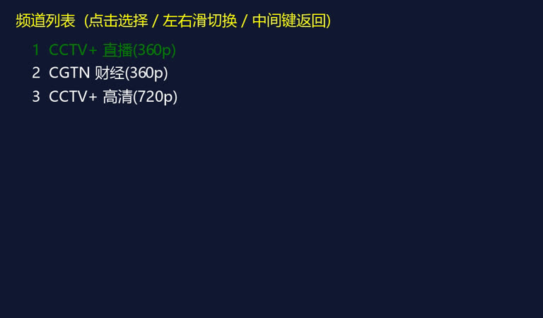 |

静态图那一路有个必须注意的点：画完要 `waitpid` 等它结束，否则后续输入事件可能把这张图打断。

### 换台过渡：给按键一个"立刻的反馈"

从杀掉旧 ffmpeg 到新频道第一帧出现，中间有 1~2 秒的空档（HLS 要重新探测+缓冲，改不掉）。这期间屏幕上还留着上一频道的最后一帧，用户看到的就是"按了键，卡住了"。所以换台时先画一张静态提示图顶上去（约 0.3 秒就能画完）：


起播慢这件事治不了，但"看得出它在切"和"以为死机了"是两种体验。第一次开机走的是"正在载入"文案，之后才是"正在切换"。

频道名里的 `\ : ' % ,` 在 `drawtext` 中都有特殊含义，必须先转义（`esc_text()`），否则频道名带这些字符时 ffmpeg 直接报错。

---

## 12. 输入映射

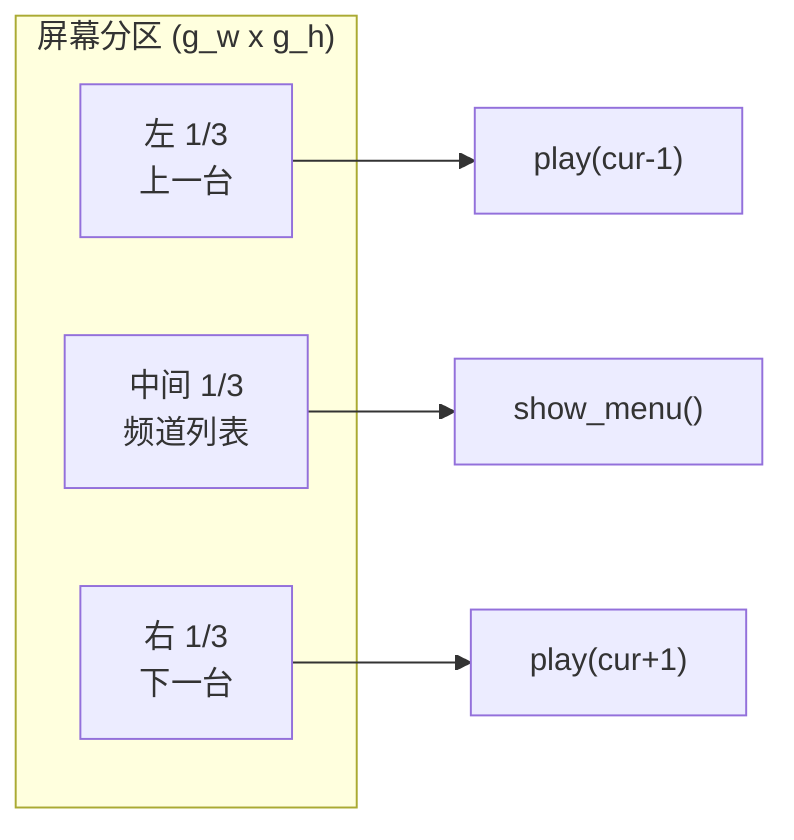

| 输入 | 事件 | 动作 |
|---|---|---|
| 触摸左 1/3 | `on_touch` | 上一台 |
| 触摸中间 1/3 | `on_touch` | 频道列表 |
| 触摸右 1/3 | `on_touch` | 下一台 |
| 菜单里点某一行 | `on_touch` | 播那个频道（行高动态计算） |
| 板载 KEY_1 / 下方向键 | `KEY_DOWN` 等 | 上一台 |
| 板载 KEY_2 / 上方向键 | `KEY_UP` 等 | 下一台 |
| ENTER / OK / SELECT / MENU | — | 菜单切换 |
| `kill -USR1/-USR2/-HUP` | 信号 | 下一台/上一台/频道列表 |

板载 gpio-keys 上报的是 `KEY_1` / `KEY_2`（bitmap `0xc`），所以做了别名映射。

---

## 13. 频道表

格式（`channels.conf`）：

```
# 井号开头是注释
频道名|URL
```

解析要点：跳过注释与空行、按第一个 `|` 切分、去掉首尾空白与 `\r\n`、最多 64 个频道。

**关于 HLS 变体**：ffmpeg 从 master.m3u8 会**默认挑码率最高的变体**。比如 CCTV+ 那个源最高是 1080p/4.6Mbps，这块板实测 **0 帧**。所以频道表里直接写低码率**子地址**：

```
CCTV+ 直播(360p)|https://.../index_4.m3u8     # 640x360 1.0M
```

注意变体编号**不通用**（另一个源里 1080p 是 `index_6`），必须看 `BANDWIDTH` 确认，不能靠编号猜。

### 当前启用的频道（2026-10 实测）

| 频道 | 分辨率 | 实测 |
|---|---|---|
| CCTV+ 直播(360p) | 640x360 | 11 FPS（放大到满屏） |
| CGTN 财经(360p) | 640x360 | 同上 |
| CCTV+ 高清(720p) | 1280x720 | 个位数帧率，留着做画质对比 |
| France 24 English/Français/Arabic/Español | **1024x576** | **13 FPS** —— 分辨率正好等于屏幕，1:1 不用放大，反而最快 |

### 集成国外源时踩的实测坑（ France 24 / DW / CGTN ）

- **France 24**：官方 HLS，最低档就是 `master_900` = 1024x576，和屏幕分辨率一样，是最理想的源。但注意 `master_5000` 是 1080p（解不动），而 master_150/400/600/1500 全是 404 —— 档位之间没有中间档。
- **DW 德国之声**：DNS 能解析，但 akamai CDN 取不到 m3u8（连接无响应），当前网络环境不可用。地址保留在频道表注释里，换网络解开注释即可。
- **CGTN（cgtn-news.m3u8 这组）**：master 文件能下载（news.cgtn.com 通），但里面引用的 360p 子地址 `live.cgtn.com` 等全都连不上 → 起播 0 帧。而且就算能播，master 会让 ffmpeg 挑最高的 720p 档。上面已启用的"CGTN 财经(360p)"走的是 cctvplus 域，是通的，不受影响。
- 集成前先在板上跑一遍 `tools/chk_src.sh`（DNS + wget 取 m3u8），**别只信 Mac 上 curl 得通**——两端 DNS 和出口不一样。

---

## 14. 实测性能数据（优化后）

### 14.1 瓶颈到底在哪

640x360/25FPS 的直播源，各环节单独实测（792MHz）：

| 环节 | 速度 | 结论 |
|---|---|---|
| 纯解码（不缩放不写屏，输出到 null） | **47 FPS** | 解码完全不是瓶颈 |
| 解码 + 缩放到 1024x600（默认 bicubic） | 8 FPS | **缩放插值吃掉 83% 的时间** |
| 解码 + 缩放 + 真写屏幕（2.4MB/帧） | ~7 FPS | 整屏写入也有份 |

结论：**贵的不是解码，是 swscale 的插值**。640x360 的源 1:1 直通（只转色彩空间）能到 44 FPS，一放大到全屏就掉到 8 FPS。

### 14.2 优化措施（按收益排序）

| # | 措施 | 收益 | 代价 |
|---|---|---|---|
| 1 | **CPU 锁 792MHz**（默认 ondemand 实测赖在 198/528MHz，满载也来不及升频） | 9.7 → 14 FPS | 功耗略增 |
| 2 | **不放大**：1:1 直通 + 四周补黑边（`scale='min(iw,屏宽)':h=-2`） | 14 → 20 FPS | 画面占屏 62%，不满屏 |
| 3 | `fast_bilinear`（ffmpeg 默认是 bicubic，最慢的一档） | 全屏档 8 → 14 FPS | 画质略糙 |
| 4 | 保持 32bpp/bgra，**不要**切 16bpp（见 14.5） | — | — |

最终：**360p 源 9.7 FPS → 20 FPS，翻倍**，且 `fast_bilinear` + 不放大之后画面稳定不抖。

### 14.3 各档端到端数据（真写屏幕）

| 缩放档 | fps | CPU |
|---|---|---|
| full 满屏放大 | 11 | 92% |
| fit（0.78 屏宽） | 14 | 79% |
| **native 不放大（默认）** | **20** | 79~92% |
| native + 限 15 帧 | 15 | 85% |

CPU 占用高不代表卡——它意味着"尽力跑满"，实际帧率上限摆在那里。想让板子凉快一点/省电，用 `IPTV_FPS=15` 限帧。

### 14.4 可调参数

| 环境变量 | 默认 | 说明 |
|---|---|---|
| `IPTV_SCALE` | `native` | `native` 不放大最快 / `fit` 0.78 屏宽折中 / `full` 满屏画质最好但只有 11 FPS |
| `IPTV_FPS` | 不限 | 限输出帧率（如 `IPTV_FPS=15`）。fps 滤镜放在缩放**之前**，被丢的帧连缩放都不用做 |
| `IPTV_LOWCPU` | 关 | 只解关键帧，720p 以上的源才需要 |
| `IPTV_SCREEN` | `lcd` | **`lcd`** 优先 LCD：fb0 设回面板原生 1024x600（电视自己缩放）；**`hdmi`** 优先电视：保持 1280x720（最清晰，但 LCD 会有黑边）。详见 §9.4 |

### 14.5 反直觉的实测结论（都是踩过的）

- **`-threads 1` 反而更慢**（19 → 14 FPS）：多线程让解码和缩放/写屏流水重叠，单核照样有收益
- **16bpp（rgb565）比 32bpp（bgra）慢**（16 vs 21 FPS）：写屏量减了半，但 rgb565 的转换路径没有 bgra 优化得好，得不偿失
- **放大 85% 屏宽和放大 100% 几乎一样贵**（本地素材实测 13 vs 12 FPS）：开销花在"放大"这个动作本身，跟放大多少关系不大。所以要么不放大（native，最快），要么直接放大满屏（画面最好）——中间档没有意义
- **1:1 的源比 360p 放大还快**：France 24 的 1024x576 正好等于屏幕分辨率，不用插值，实测 13 FPS，比 640x360 放大到满屏（11 FPS）还流畅——挑源就挑分辨率接近 1024x576 的
- **libopenh264 起不来**：ffmpeg 编译时带了这个解码器，实际解码 0 帧，老实用内置 h264
- 这个 ffmpeg 4.2.3 **没有 `-framedrop` 选项**，加了直接 `Unrecognized option` 起不来（旧版低延迟分支里就有一个，rtmp/rtsp 源其实一直是坏的，已修）

---

## 15. 踩坑清单

按"被坑程度"排序，每一条都是实测出来的：

| # | 现象 | 根因 | 对策 |
|---|---|---|---|
| 1 | 进程在跑、日志正常，但**画面根本没显示** | fbdev 的 `pix_fmt` 与 fb0 位深不匹配（16bpp 要 `rgb565le`） | 启动读 sysfs 自动探测；用 `md5sum /dev/fb0` 连采验证 |
| 2 | 看一会儿**自己黑屏** | 内核 `consoleblank=600` | `fw_setenv` 加 `consoleblank=0` + tty 转义 + 每 10 秒维护 |
| 3 | 上面那条修不动 | `/sys/.../consoleblank` 是**只读**的 | 改走 `/dev/tty1` 的 `ESC[9;0]` |
| 4 | 屏幕上**光标一直闪** | fbcon 与 ffmpeg 抢显存 | 关 `cursor_blink` + 解绑 **vtcon1**（不是 vtcon0） |
| 5 | 播放 1080p 源 0 帧 | HLS 默认挑最高码率变体 | 频道表直接写低码率子地址 |
| 6 | 加低延迟参数后 HLS 起播失败 | `nobuffer`/极小 `analyzeduration` 压掉了探测数据 | 只对 rtmp/rtsp/udp/rtp 启用 |
| 7 | 开机后串口**敲命令没反应** | 启动脚本前台阻塞了 busybox init | 整个流程包在后台 `( ... ) &` |
| 8 | https 报 `certificate is not yet valid` | 无 RTC 电池，时间回到 1970 | 联网后先 `ntpdate` 对时 |
| 9 | 菜单/提示图被打断 | 静态图 ffmpeg 还没画完 | 画完 `waitpid` 等待 |
| 10 | 屏幕被板厂界面占住 | `S99myirhmi2` 抢屏幕 | 启动脚本里停掉它 |
| 11 | WiFi 一直连不上 | RTL8723BU 进省电 + NetworkManager 抢 wlan1 | 重载驱动关省电 + 停 NetworkManager + 用 wlan1 |
| 12 | 部署后脚本起不来（Exit 126） | ZMODEM 传输丢了执行位 | `make deploy` 里补 `chmod +x` |
| 13 | 改完代码板子上没变化 | 播放器还在跑，日志打断 ZMODEM 传输，push 静默失败 | 部署后**一定要对比 md5**（`md5sum /root/03_iptv` vs 本地） |
| 14 | 开机动画被跳过后**立刻换台** | 跳过时的输入事件还留在队列里 | 跳过时必须把事件 `read` 出来丢掉 |
| 15 | 串口 base64 传回的**图片打不开** | 115200 下 CPU 一忙就丢字符 | 收完检查 `FF D9` 结尾；有网就优先 scp |
| 16 | 插上 HDMI 后**画面错位/没画面** | 驱动读电视 EDID 后把 fb0 从 1024x600/32bpp 改成 1280x720/16bpp，播放器还按旧参数输出 | 主循环每 2 秒查分辨率，变了就重探参数并重开 ffmpeg（见 §9.4） |
| 17 | 插着 HDMI 时 **LCD 左边约 1/5 黑屏** | 面板固定 1024x600、不会缩放，收到 1280x720 信号只能按自己时序采 | 用面板设备树时序把 fb0 改回 1024x600（默认已固化到开机流程，`IPTV_SCREEN=hdmi` 可反过来优先电视） |
| 16 | rtmp/rtsp 源**一启动就退出** | 命令里带了 `-framedrop`，这个 ffmpeg 4.2.3 没编该选项 | 删掉；丢帧保实时用 `IPTV_FPS` 限帧实现 |
| 17 | 加了 `-threads 1` 反而**更卡** | 单核上多线程能让解码与缩放/写屏流水重叠 | 不设 threads，让 ffmpeg 自己决定 |
| 18 | 想**省写屏带宽**切 16bpp，结果更慢 | rgb565 转换路径没有 bgra 优化得好 | 保持 32bpp/bgra |

---

## 16. 已知限制与可扩展方向

**限制**

- 纯 CPU 软解，360p 约 20 FPS（`native` 档，画面不满屏），720p 及以上基本不可用。
- 无电子节目单（EPG）、无音量 UI、无录制。
- 触摸量程与屏幕分辨率不同源时（raw 量程 1024x600 vs 屏幕 1280x720），按比例映射，不影响分区判断但精度略降。
- fbcon 解绑后，屏幕不再显示任何 console 文字——调试只能看串口。

**可以往哪走**

| 方向 | 思路 |
|---|---|
| 更流畅 | 板上有 PXP 硬件 2D 加速器（`/dev/pxp_device`），但 gstreamer 没装对应 transform 插件；自己写 PXP 调用（mmap DMA + ioctl）把缩放/色彩转换交给硬件，预计还能再翻倍。最省事的还是换带 VPU 的平台 |
| 硬解 | i.MX6ULL 无 VPU，需换 i.MX6Q/DL 或用 VPU 驱动 |
|  richer UI | 用 LVGL/Qt 画 OSD（但会与 ffmpeg 抢 fb0，需要双缓冲或 overlay） |
| 远程控制 | 加一个 socket/HTTP 控制端，替换现在的信号方式 |
| 音频 | 已支持 `-a` 走 alsa，只是这块板没接音箱所以默认关 |

---

## 17. 构建与部署

```bash
make -C examples/03_iptv          # 交叉编译
make -C examples/03_iptv deploy   # 推到板子 + 补执行位
make -C examples/03_iptv deploy-reboot  # 部署并重启验证开机自启动
```

`deploy` 会依次：杀掉正在跑的播放器（否则它的日志会打断 ZMODEM 传输）→ 推二进制 → 推频道表 → 推自启动脚本 → `chmod +x`。

板上手动控制：

```bash
/etc/init.d/S95iptv start|stop|restart
kill -USR1 $(pidof 03_iptv)   # 下一台
```

---

## 18. 抓实际屏幕截图

本文档里的实拍图都是这么来的——板上 ffmpeg 直接把 `/dev/fb0` 存成图：

```bash
# 板子上抓当前画面(缩到 768 宽, jpeg 质量 4, 约 20~60KB)
ffmpeg -f fbdev -i /dev/fb0 -frames:v 1 -vf scale=768:-1 -q:v 4 -y /tmp/shot.jpg

# 有网络时用 scp 取回(推荐)
scp root@<板子IP>:/tmp/shot.jpg .
```

或者用现成工具（走串口 base64 回传，不依赖网络）：

```bash
python3 tools/fbshot.py -o shot.jpg                      # 抓当前画面
python3 tools/fbshot.py -o boot.jpg --pre "/root/03_iptv &" --delay 3
```

⚠️ 实测坑：串口 base64 回传**会丢字符**（115200 下 CPU 一忙就丢），收到的 jpg 可能损坏。
所以优先 scp；必须走串口时，收完检查文件是否以 `FF D9` 结尾（完整 JPEG 的标志）。
